# EduSense AI

Automated classroom attendance using face recognition. Take one photo of the class and every recognised student is marked present. Also tracks per-subject attendance %, student profiles linked to roll numbers, quiz / assignment / mid / final marks, and exports.

Built for the AI Theory course (BSAI, Superior University Lahore).

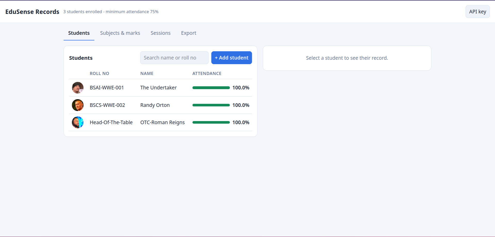

## Features

- **One-photo attendance**: snap the class, the server detects and matches every face.
- **Per-subject sessions**: attendance % per student, per subject and overall (red below the minimum, default 75%).
- **Student profiles**: roll number, name, program, email, phone and face thumbnail.
- **Marks**: quizzes, assignments, mid-term and final per subject, with totals and percentages.
- **Manual override**: fix any mistake by tapping a name present/absent.
- **Exports**: all students in one XLSX, a PDF report per student, a ZIP of all PDFs, and a CSV per session.
- **PC webcam on the web page**: enrol students and take attendance from the browser; admin also gets a private log of when each teacher was seen.
- **Accounts**: admin key for the admin, username + password per teacher, managed from the app or dashboard.
- **Two clients**: Android app (Kivy) and a web dashboard, both on the same server.
- **Polished app UI (v0.5.0)**: light/dark mode, adjustable font size, grouped recent sessions, no overlapping text.

## Screenshots

### Android app (v0.5.0)

| Login and home | Session and student record |
|---|---|
| 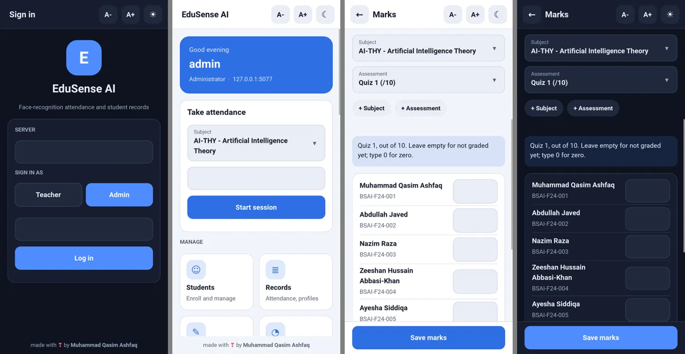 | 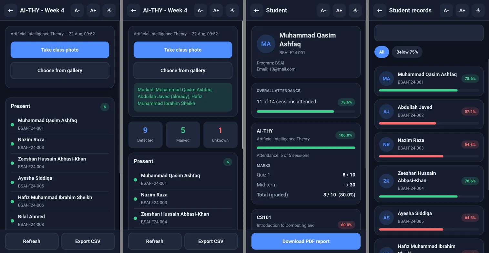 |

| Admin: teachers and dialogs | Teacher account |
|---|---|
| 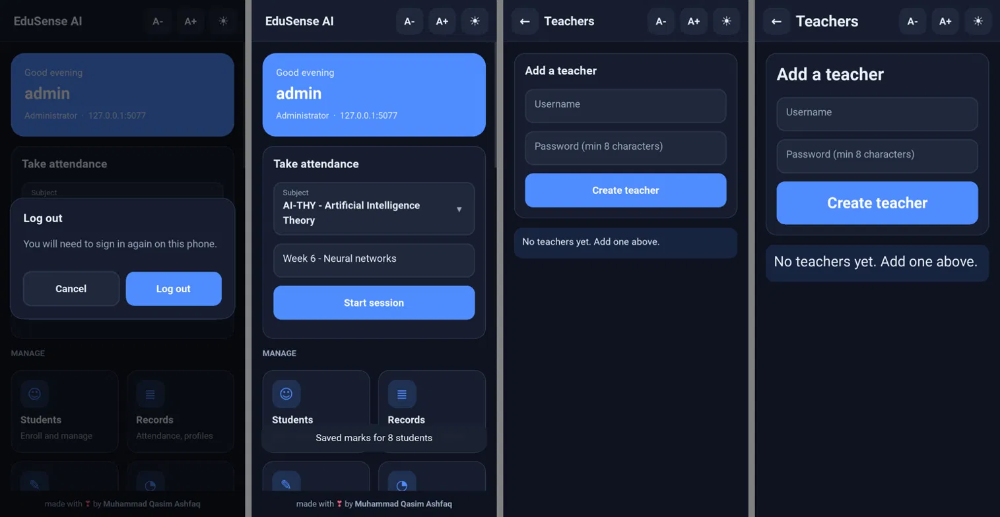 | 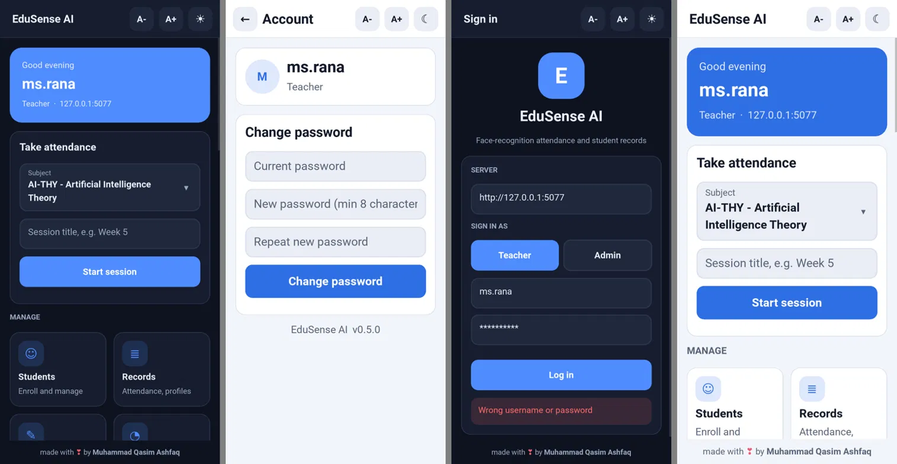 |

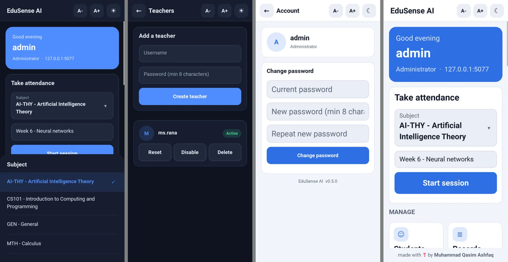

### Web dashboard

| Student profile | Marks entry |
|---|---|
| 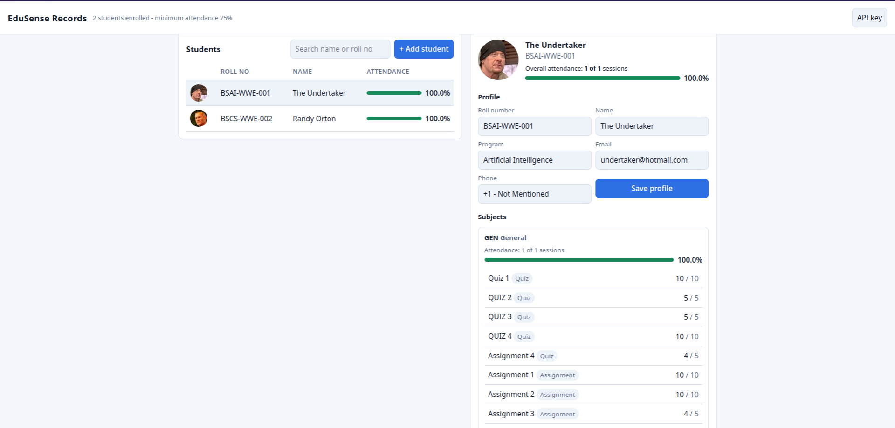 | 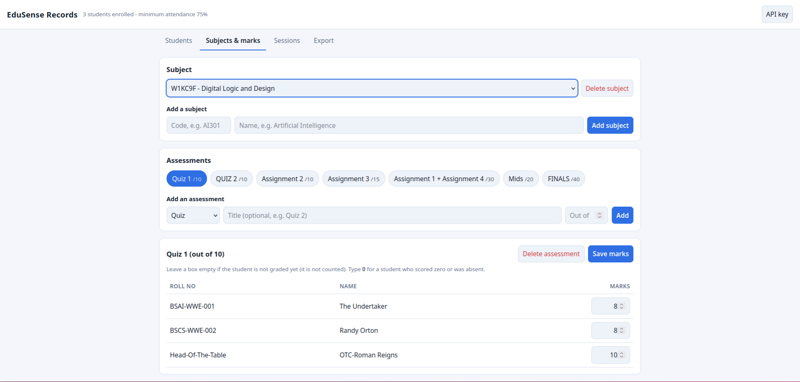 |

| Enrol a student | Reports and exports |
|---|---|
| 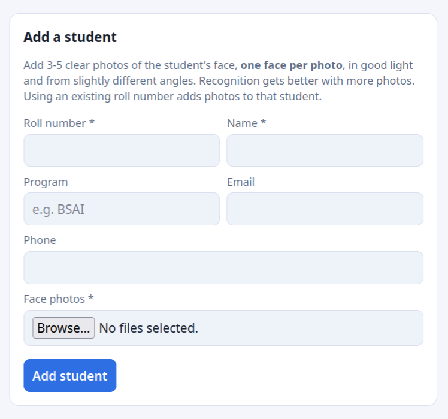 | 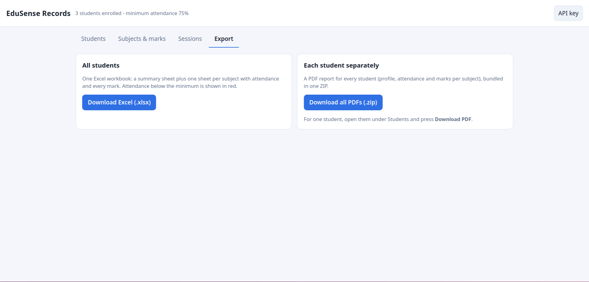 |

| Attendance sessions | Per-subject card in a student profile |
|---|---|
| 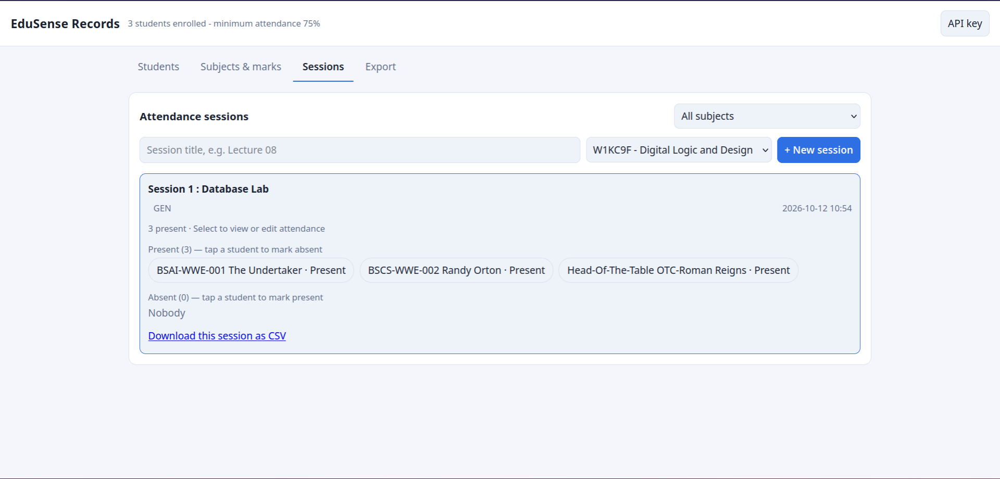 | 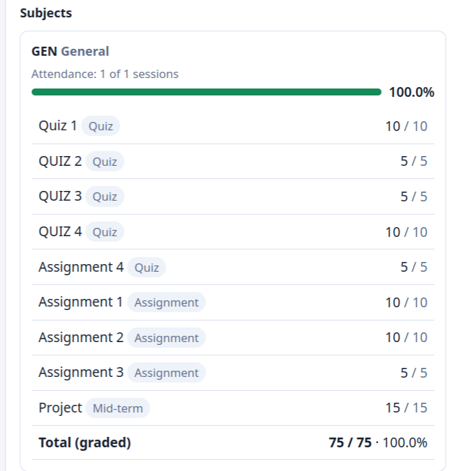 |

### Sample photos

| Class photo | Enrolment photos |
|---|---|
|  |    |

## What's new in v0.5.0

- Redesigned Android app: top bar on every screen, rounded cards, bottom-sheet pickers, confirm dialogs and toasts. Every size follows its content, so text never overlaps at any screen density.
- Nothing about sessions is shown before login. After login the home screen greets you, has a **Take attendance** card and tiles for Students, Records, Marks, Dashboard and Account.
- **Recent sessions** are grouped as Today / Yesterday / This week / Earlier, with subject filter chips.
- **A- / A+** font size buttons (5 steps) and a **light / dark** switch in the top bar. Both are remembered.
- Android back button returns to the previous screen. The version number lives on the Account screen.
- Bundles the DejaVu Sans font (licence in `mobile/assets/DEJAVU-LICENSE.txt`) for arrow, sun/moon and heart glyphs. The server is unchanged.

## Accounts and login

Two kinds of users:

- **Admin** (you): logs in with the secret **admin key** as the username and **no password**. Admin can add, disable, reset and delete teachers, and delete students, subjects and assessments.
- **Teacher**: logs in with the username and password the admin gave them. Teachers can take attendance, enrol students, enter marks and view records/exports. They can change their own password (app: Home -> Account, dashboard: Change password).

Set the admin key on the server (it is **never** stored in the app or in the repo):

```bash
python -c "import secrets; print(secrets.token_urlsafe(75))"     # prints a 100-character key
EDUSENSE_ADMIN_KEY=<that key> python app.py                      # Windows: set EDUSENSE_ADMIN_KEY=... first
```

Rules: key at least 32 characters; usernames 3-32 characters (letters, digits, `. _ -`); passwords at least 8 characters and stored only as salted hashes. Five wrong logins for one username lock it for 10 minutes. Login tokens last 12 hours (`EDUSENSE_TOKEN_HOURS`); disabling a teacher or resetting their password logs them out immediately. Without `EDUSENSE_ADMIN_KEY` the admin login is disabled.

Passwords travel in clear text over plain `http://`. That is acceptable on a private classroom Wi-Fi; on the internet use HTTPS (Render provides it).

## Camera on the web page, and teacher presence

The dashboard can use the PC webcam (browser asks permission):

- **Add student -> webcam**: start the camera, press *Capture photo* 3-5 times (click a thumbnail to remove it), then *Add student*.
- **Sessions -> Take attendance with the PC camera**: pick subject + title, *Start session*, start the camera, then *Scan class*, or tick *auto-scan* (every 10-60 s). Each scan only adds people. You can also upload a photo instead.
- **Teachers -> Train face** (admin): capture 3-5 photos of a teacher. From then on, whenever a class photo is scanned (web or phone app) and that teacher's face is in it, the server logs a **sighting**. Sightings never touch attendance or marks.
- **Teachers -> Teacher presence** (admin only): per teacher, how many times the camera detected them, in how many sessions, when last, plus a list of recent detections. Teachers only see "N staff faces skipped" and cannot open any of this.
- Several detections of one teacher in the same session within 60 seconds count once (`EDUSENSE_SIGHTING_GAP`), so auto-scan does not inflate the number.

The browser only allows the camera on **https://** or **http://localhost**. On the server PC open `http://localhost:5000`; from other devices on plain `http://192.168...` the camera button will say it is blocked (file upload still works). On Render (https) it just works.

Tell teachers about the presence log and get their consent: it processes their biometric data and records when they were in class.

## How it works

```
Android app / Web dashboard  --HTTP-->  Flask server  -->  SQLite
                                            |
                                   face_recognition (dlib)
```

1. Enrol a student with 3-5 photos. The server stores 128-d face encodings.
2. Pick a subject, start a session and upload a class photo.
3. The server fixes EXIF rotation, downsizes to 1600 px, detects faces (HOG) and compares each against stored encodings (tolerance 0.5).
4. Matches are marked present. Fix any mistake in the app or dashboard.

**Why two parts?** `dlib` (the engine behind `face_recognition`) cannot be compiled by Buildozer, so recognition runs on a laptop/server and the phone is the camera + UI.

## Project structure

```
edusense/
├── server/                      Flask + face_recognition
│   ├── app.py                   recognition, records, marks, exports
│   ├── static/dashboard.html    records dashboard (http://<server-ip>:5000/)
│   ├── requirements.txt
│   ├── requirements-render.txt  prebuilt dlib for Render
│   └── render-build.sh
├── mobile/                      Kivy Android app (Buildozer)
│   ├── main.py                  screens + app logic
│   ├── api.py                   HTTP client for the server
│   ├── theme.py                 light/dark colours and font scale
│   ├── widgets.py               bottom sheet, dialog, toast, select
│   ├── edusense.kv              UI layout and styles
│   ├── assets/                  DejaVu Sans icon font + licence
│   ├── buildozer.spec
│   └── extra_manifest_application_arguments.xml   (allows http:// on the LAN)
└── docs/                        screenshots
```

## 1. Run the server

```bash
cd server
python -m venv .venv && source .venv/bin/activate    # Windows: .venv\Scripts\activate
pip install -r requirements.txt                      # dlib compiles: needs cmake + a C++ compiler
EDUSENSE_ADMIN_KEY=choose-a-long-secret python app.py  # Windows: set EDUSENSE_ADMIN_KEY=... first
```

Find your laptop's LAN IP (`ipconfig` / `ip a`), e.g. `192.168.1.23`, and allow port 5000 through the firewall. Phone and laptop must be on the same Wi-Fi. Quick check from the phone browser: `http://192.168.1.23:5000/api/health`.

No Wi-Fi route? Plug in the phone with USB debugging and run `adb reverse tcp:5000 tcp:5000`, then use `http://localhost:5000` in the app.

| Env var | Purpose | Default |
|---|---|---|
| `EDUSENSE_ADMIN_KEY` | Secret admin key (32+ chars). Log in with it, no password, for admin rights | none (admin login disabled) |
| `EDUSENSE_TOKEN_HOURS` | How long a login lasts | `12` |
| `EDUSENSE_TOLERANCE` | Match threshold, lower is stricter | `0.5` |
| `EDUSENSE_MIN_ATTENDANCE` | Attendance % flagged red | `75` |
| `EDUSENSE_DB` | SQLite file path | `./edusense.db` |
| `PORT` | Server port | `5000` |

## 2. Build the Android app

Buildozer needs Linux (or WSL2 on Windows).

```bash
cd mobile
pip install buildozer cython
buildozer -v android debug          # first build downloads SDK/NDK, takes a while
adb install bin/*.apk
```

`buildozer.spec` pins `p4a.branch = v2024.01.21`. Newer python-for-android builds Python 3.14, which breaks Kivy 2.3.0. If the phone still shows an old version after a rebuild, run `rm -rf .buildozer/android/app bin/*.apk`, rebuild, then `adb uninstall org.edusense.edusense` before installing.

## 3. Use it

**Phone app**

1. Login screen: enter `http://<server-ip>:5000`, then log in as **Teacher** (username + password) or **Admin** (admin key).
2. **Students** tile -> **Enroll new student**: roll no, name, 3-5 front-facing photos.
3. Home -> **Take attendance**: choose the **subject**, type a session title, **Start session**.
4. **Take class photo** (or choose from gallery). Recognised students are marked present. **Export CSV** downloads the sheet.
5. **Records**: attendance % for everyone, tap a student for per-subject attendance, marks and a PDF.
6. **Marks**: pick a subject and assessment, type marks for the class, **Save marks**. Use **+ Subject** and **+ Assessment** (Quiz, Assignment, Mid-term, Final) to add new ones.
7. **Dashboard**: opens the web dashboard in the phone browser. **Account**: change your password. Admin also sees **Teachers**.
8. **A- / A+** and the sun/moon button in the top bar change font size and light/dark mode.

**Web dashboard** (`http://<server-ip>:5000/`)

- **Students**: add and edit students, attendance % per student, profile, marks per subject and PDF report.
- **Subjects & marks**: add subjects and assessments with a maximum, then fill a marks grid for the whole class. Empty box = not graded yet (not counted); type 0 for zero.
- **Sessions**: every session; click one to correct present/absent.
- **Export**: one Excel workbook for everyone (summary + one sheet per subject), or a ZIP with a PDF per student.

Assumptions: every enrolled student takes every subject, and a subject's marks percentage is total obtained / total maximum over graded assessments.

### Upgrading from an older version

```bash
cd server && source .venv/bin/activate && pip install -r requirements.txt
python app.py     # the existing database upgrades itself; old sessions go under the "General" subject
```

Rebuild the APK to get the new screens: copy the new `mobile/` over the old one, delete `mobile/.buildozer/android/app` and `mobile/bin/*.apk`, run `buildozer -v android debug`, then uninstall the old app and install the new APK.

## 4. Deploy online (Render)

Use a **Web Service**, not a Static Site.

- Root directory: `server`
- Build command: `./render-build.sh`
- Start command: `gunicorn app:app --workers 1 --timeout 120`
- Environment: `EDUSENSE_ADMIN_KEY=<100-character secret>`

Free instances have 512 MB RAM and lose the database on restart. For real use take a paid instance with a persistent disk and set `EDUSENSE_DB=/data/edusense.db`. Then enter the `https://...onrender.com` URL in the app.

## API

| Method | Endpoint | Purpose |
|---|---|---|
| GET | `/api/health` | Status |
| POST | `/api/login` | Log in (teacher or admin key) |
| GET/POST | `/api/students` | List / enrol |
| GET/PUT/DELETE | `/api/students/<id>` | Record / edit / remove |
| GET | `/api/students/<id>/report.pdf` | Student report |
| GET/POST | `/api/subjects` | Subjects |
| GET/POST | `/api/subjects/<id>/assessments` | Quiz, assignment, mid, final |
| GET/PUT | `/api/assessments/<id>/marks` | Marks entry |
| GET/POST | `/api/sessions` | Attendance sessions |
| POST | `/api/sessions/<id>/recognize` | Upload class photo |
| POST | `/api/sessions/<id>/mark` | Manual present/absent |
| GET | `/api/sessions/<id>/export.csv` | Session CSV |
| GET | `/api/export/all.xlsx` | All students workbook |
| GET | `/api/export/reports.zip` | Per-student PDFs |

## Tuning

- Enrol 3-5 photos per student in different lighting. This helps more than anything else.
- `EDUSENSE_TOLERANCE`: lower = stricter, fewer false matches, more misses.
- The HOG detector is CPU friendly but misses faces smaller than about 80 px. Stand back far enough to fit the class, not so far that faces shrink.

## Privacy

Face data is biometric data. Get students' consent, keep `EDUSENSE_ADMIN_KEY` secret and out of Git, use HTTPS if the server is public, and never expose the database.

## Known limits

- `plyer`'s camera launches the system camera app. On some Android 10+ phones it can crash with a file-URI error. If so, use **Choose from gallery** or swap in `camera4kivy`.
- Only plain HTTP on the local network is configured. Use HTTPS if you expose the server.
- Not a replacement for human review. Check unmatched faces.

## Tech stack

Python, Flask, SQLite, dlib / face_recognition, Pillow, openpyxl, ReportLab, Kivy, Buildozer.

## License

MIT. The bundled DejaVu Sans font has its own free licence (`mobile/assets/DEJAVU-LICENSE.txt`).

Made with ❣ by Muhammad Qasim Ashfaq
